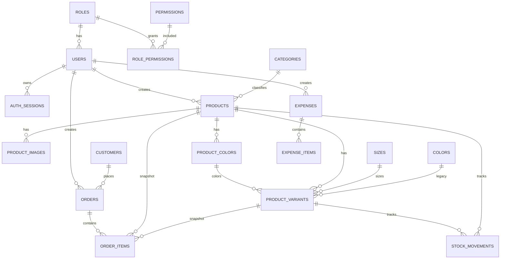

# Database Schema

Sumber kebenaran schema adalah model GORM di `internal/models` dan migration Atlas di `migrations/`.

Migration:

- `20261104075754_init.sql` - schema awal
- `20261104084102_add_order_stock_deducted.sql` - kolom `orders.stock_deducted`
- `20261104131154_add_stock_movements.sql` - tabel `stock_movements`
- `20261104162303_add_catalog_admin_fields.sql` - field catalog produk + `catalog_settings`

## Konvensi

- Primary key: `uuid`, default `gen_random_uuid()`.
- Timestamp: `timestamptz`, disimpan UTC.
- Tanggal bisnis: `date`.
- Uang: `bigint` rupiah penuh.
- Soft delete: `deleted_at timestamptz` pada master/history table.
- Child rows dihapus permanen.
- Unique index tetap berlaku untuk row soft-deleted. Nilai unik tidak dipakai ulang.
- Status memakai `varchar` + check constraint.
- Semua foreign key yang dipakai filter/join memiliki index.

## ERD

## Auth dan RBAC

### roles

| Kolom | Tipe | Aturan |
|---|---|---|
| id | uuid | PK, default `gen_random_uuid()` |
| name | varchar(50) | not null, unique |
| level | smallint | not null, unique, check 0..3 |
| description | varchar(255) | nullable |
| is_system | boolean | not null, default false |
| created_at, updated_at | timestamptz | not null |

Level: `0` Developer, `1` Super Admin, `2` Admin, `3` Staff.

### permissions

| Kolom | Tipe | Aturan |
|---|---|---|
| id | uuid | PK |
| key | varchar(100) | not null, unique, contoh `products.create` |
| page | varchar(50) | not null |
| action | varchar(20) | not null |
| label | varchar(100) | not null |
| created_at, updated_at | timestamptz | not null |

Unique composite: `(page, action)`.

### role_permissions

| Kolom | Tipe | Aturan |
|---|---|---|
| role_id | uuid | PK, FK roles, cascade delete |
| permission_id | uuid | PK, FK permissions, cascade delete, index |
| created_at | timestamptz | not null |

Level 0 dan 1 tidak memakai tabel ini karena bypass di middleware.

### users

| Kolom | Tipe | Aturan |
|---|---|---|
| id | uuid | PK |
| role_id | uuid | not null, FK roles, restrict delete, index |
| name | varchar(100) | not null |
| username | varchar(50) | not null, unique |
| email | varchar(255) | not null, unique |
| password_hash | varchar(255) | not null, bcrypt cost 12 |
| phone | varchar(30) | nullable |
| avatar_key | varchar(255) | object key R2 |
| is_active | boolean | not null, default true, index |
| last_login_at | timestamptz | nullable |
| created_at, updated_at | timestamptz | not null |
| deleted_at | timestamptz | soft delete, index |

### auth_sessions

| Kolom | Tipe | Aturan |
|---|---|---|
| id | uuid | PK, dipakai sebagai claim `sid` |
| user_id | uuid | not null, FK users, cascade delete, index |
| refresh_token_hash | char(64) | not null, unique, SHA-256 hex |
| user_agent | varchar(255) | nullable |
| ip_address | varchar(45) | nullable |
| expires_at | timestamptz | not null, index |
| revoked_at | timestamptz | nullable |
| last_used_at | timestamptz | nullable |
| created_at | timestamptz | not null |

Satu row per login. Refresh token dirotasi pada row yang sama.

## Katalog produk

### categories

| Kolom | Tipe | Aturan |
|---|---|---|
| id | uuid | PK |
| name | varchar(100) | not null, unique |
| slug | varchar(120) | not null, unique |
| description | text | nullable |
| created_at, updated_at | timestamptz | not null |
| deleted_at | timestamptz | soft delete, index |

### sizes

| Kolom | Tipe | Aturan |
|---|---|---|
| id | uuid | PK |
| name | varchar(20) | not null, unique |
| sort_order | integer | not null, default 0 |
| created_at, updated_at | timestamptz | not null |

### colors

| Kolom | Tipe | Aturan |
|---|---|---|
| id | uuid | PK |
| name | varchar(50) | not null, unique |
| hex_code | varchar(7) | nullable, contoh `#112233` |
| created_at, updated_at | timestamptz | not null |

### product_colors

Warna custom per produk. Satu warna memiliki satu gambar preview.

| Kolom | Tipe | Aturan |
|---|---|---|
| id | uuid | PK |
| product_id | uuid | not null, FK products, cascade delete, index |
| name | varchar(50) | not null |
| hex_code | varchar(7) | nullable, contoh `#112233` |
| image_key | varchar(255) | nullable, key R2 |
| sort_order | integer | not null, default 0, index |
| created_at, updated_at | timestamptz | not null |

Unique composite: `(product_id, name)`.

### products

| Kolom | Tipe | Aturan |
|---|---|---|
| id | uuid | PK |
| category_id | uuid | nullable, FK categories, set null |
| name | varchar(150) | not null, index |
| slug | varchar(180) | not null, unique |
| description | text | nullable |
| status | varchar(20) | not null, default `draft`, check `draft/active/archived`, index |
| shopee_url | varchar(255) | nullable |
| shopee_price | bigint | not null, default 0, check >= 0 |
| details | jsonb | daftar detail catalog |
| badge | varchar(50) | nullable |
| badge_tone | varchar(20) | not null, default `light`, check `light/accent` |
| sort_order | integer | not null, default 0, index |
| created_by_id | uuid | nullable, FK users, set null |
| created_at, updated_at | timestamptz | not null |
| deleted_at | timestamptz | soft delete, index |

### product_images

| Kolom | Tipe | Aturan |
|---|---|---|
| id | uuid | PK |
| product_id | uuid | not null, FK products, cascade delete, index |
| object_key | varchar(255) | not null, key R2 |
| alt_text | varchar(150) | nullable |
| sort_order | integer | not null, default 0 |
| is_primary | boolean | not null, default false |
| created_at | timestamptz | not null |

Satu gambar primary per produk ditegakkan di service.

### product_variants

| Kolom | Tipe | Aturan |
|---|---|---|
| id | uuid | PK |
| product_id | uuid | not null, FK products, cascade delete |
| size_id | uuid | not null, FK sizes, restrict delete |
| color_id | uuid | nullable, FK colors, restrict delete; legacy compatibility |
| product_color_id | uuid | nullable, FK product_colors, restrict delete, index |
| sku | varchar(64) | not null, unique |
| price | bigint | not null, default 0, check >= 0 |
| stock | integer | not null, default 0, check >= 0 |
| is_active | boolean | not null, default true |
| created_at, updated_at | timestamptz | not null |

Unique composite baru: `(product_id, size_id, product_color_id)`.
Unique lama `(product_id, size_id, color_id)` dipertahankan selama masa transisi.

### catalog_settings

Konten halaman catalog publik.

| Kolom | Tipe | Aturan |
|---|---|---|
| id | uuid | PK |
| key | varchar(20) | not null, unique, default `default` |
| promo_badge | varchar(100) | nullable |
| promo_title | varchar(150) | nullable |
| promo_description | text | nullable |
| promo_note | text | nullable |
| promo_cta_label | varchar(100) | nullable |
| page_eyebrow | varchar(100) | nullable |
| page_title | varchar(150) | nullable |
| page_title_accent | varchar(150) | nullable |
| page_description | text | nullable |
| page_footnote | text | nullable |
| cta_eyebrow | varchar(100) | nullable |
| cta_title | varchar(150) | nullable |
| cta_title_accent | varchar(150) | nullable |
| cta_description | text | nullable |
| cta_label | varchar(100) | nullable |
| cta_image_url | varchar(255) | nullable |
| cta_secondary_image_url | varchar(255) | nullable |
| shopee_store_url | varchar(255) | nullable |
| created_at, updated_at | timestamptz | not null |

## Customer dan order

### customers

| Kolom | Tipe | Aturan |
|---|---|---|
| id | uuid | PK |
| name | varchar(100) | not null, index |
| phone | varchar(30) | not null, index |
| email | varchar(255) | nullable, index |
| address | text | nullable |
| city | varchar(100) | nullable |
| province | varchar(100) | nullable |
| postal_code | varchar(10) | nullable |
| notes | text | nullable |
| created_at, updated_at | timestamptz | not null |
| deleted_at | timestamptz | soft delete, index |

### orders

| Kolom | Tipe | Aturan |
|---|---|---|
| id | uuid | PK |
| order_number | varchar(32) | not null, unique |
| customer_id | uuid | not null, FK customers, restrict delete, index |
| status | varchar(20) | not null, default `pending`, check, index |
| payment_status | varchar(20) | not null, default `unpaid`, check, index |
| payment_method | varchar(30) | nullable |
| paid_at | timestamptz | nullable, index |
| shipping_status | varchar(20) | not null, default `pending`, check, index |
| courier | varchar(50) | nullable |
| tracking_number | varchar(100) | nullable, index |
| shipped_at, delivered_at | timestamptz | nullable |
| recipient_name | varchar(100) | not null, snapshot |
| recipient_phone | varchar(30) | not null, snapshot |
| shipping_address | text | not null, snapshot |
| shipping_city | varchar(100) | nullable |
| shipping_province | varchar(100) | nullable |
| shipping_postal_code | varchar(10) | nullable |
| subtotal | bigint | not null, default 0, check >= 0 |
| discount_amount | bigint | not null, default 0, check >= 0 |
| shipping_cost | bigint | not null, default 0, check >= 0 |
| total_amount | bigint | not null, default 0, check >= 0 |
| notes | text | nullable |
| created_by_id | uuid | nullable, FK users, set null |
| stock_deducted | boolean | not null, default false, penanda stok sudah dikurangi |
| created_at, updated_at | timestamptz | not null |
| deleted_at | timestamptz | soft delete, index |

Nilai status:

- `status`: `pending`, `confirmed`, `processing`, `shipped`, `completed`, `cancelled`
- `payment_status`: `unpaid`, `paid`, `refunded`
- `shipping_status`: `pending`, `picked_up`, `in_transit`, `delivered`, `returned`

### order_items

| Kolom | Tipe | Aturan |
|---|---|---|
| id | uuid | PK |
| order_id | uuid | not null, FK orders, cascade delete, index |
| product_id | uuid | nullable, FK products, set null |
| variant_id | uuid | nullable, FK product_variants, set null |
| product_name | varchar(150) | not null, snapshot |
| variant_label | varchar(100) | not null, snapshot, contoh `Black / L` |
| sku | varchar(64) | not null, snapshot |
| price | bigint | not null, check >= 0, snapshot |
| quantity | integer | not null, check > 0 |
| subtotal | bigint | not null, check >= 0 |
| created_at | timestamptz | not null |

## Accounting

### expenses

| Kolom | Tipe | Aturan |
|---|---|---|
| id | uuid | PK |
| title | varchar(150) | not null |
| category | varchar(50) | not null, default `operational`, index |
| vendor | varchar(150) | nullable |
| expense_date | date | not null, index |
| payment_method | varchar(30) | nullable |
| total_amount | bigint | not null, default 0, check >= 0 |
| receipt_key | varchar(255) | object key R2 |
| notes | text | nullable |
| created_by_id | uuid | nullable, FK users, set null |
| created_at, updated_at | timestamptz | not null |
| deleted_at | timestamptz | soft delete, index |

Kategori: `operational`, `production`, `marketing`, `restock`, `other`.

### stock_movements

Ledger audit perubahan stok. Snapshot SKU/label disimpan agar histori tetap terbaca setelah varian dihapus.

| Kolom | Tipe | Aturan |
|---|---|---|
| id | uuid | PK |
| variant_id | uuid | nullable, FK product_variants, set null |
| product_id | uuid | nullable, FK products, set null |
| sku | varchar(64) | not null, snapshot |
| variant_label | varchar(100) | not null, snapshot |
| type | varchar(30) | not null, check `initial/adjustment/order/cancel/return` |
| quantity | integer | not null, signed, check <> 0 |
| stock_before | integer | not null, check >= 0 |
| stock_after | integer | not null, check >= 0 |
| reference_type | varchar(30) | nullable, `product/order/manual` |
| reference_id | uuid | nullable, index bersama reference_type |
| note | text | nullable |
| created_by_id | uuid | nullable, FK users, set null |
| created_at | timestamptz | not null |

Index: `variant_id`, `product_id`, `type`, `(reference_type, reference_id)`, `created_by_id`.

### expense_items

| Kolom | Tipe | Aturan |
|---|---|---|
| id | uuid | PK |
| expense_id | uuid | not null, FK expenses, cascade delete, index |
| name | varchar(150) | not null |
| quantity | numeric(12,2) | not null, default 1, check > 0 |
| unit | varchar(20) | default `pcs` |
| unit_price | bigint | not null, check >= 0 |
| subtotal | bigint | not null, check >= 0 |
| created_at | timestamptz | not null |

## Seed RBAC

Role dibuat oleh `cmd/seed`:

| Level | Role | Akses |
|---|---|---|
| 0 | Developer | bypass semua permission |
| 1 | Super Admin | bypass semua permission |
| 2 | Admin | operasional penuh, user view/create/update, role view |
| 3 | Staff | overview view, products view, orders view/create/update, customers view/create/update, accounting view/create |

Katalog permission: `overview.view`; `products.*`; `orders.*`; `customers.*`; `accounting.*`; `users.*`; `roles.view`, `roles.update`.

Permission default hanya diisi jika role belum memiliki row permission. Kustomisasi role tidak tertimpa saat seed dijalankan ulang.
